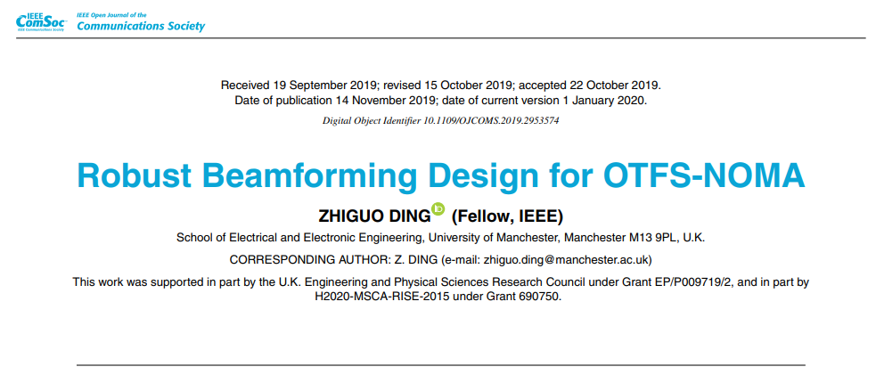
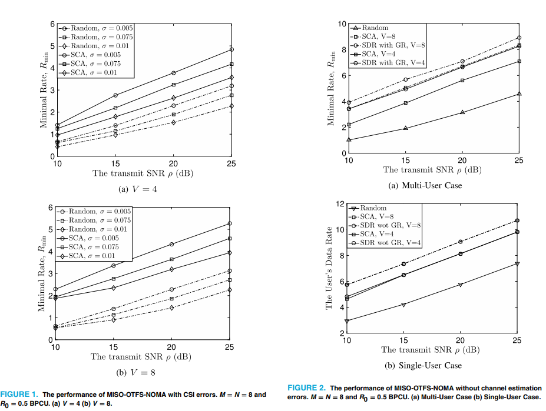

# [Waveform Design]Robust Beamforming Design for Non-Orthogonal Multiple Access (OTFS-NOMA) Networks with Orthogonal Time-Frequency Space Modulation Aided

This paper investigates the beamforming design problem for an OTFS-NOMA network, which involves non-orthogonal multiple access (NOMA) with high mobility users sharing spectrum with multiple low mobility NOMA users. Specifically, the beamforming design is formulated as an optimization problem, aiming to maximize the data rate of low mobility NOMA users while ensuring the target data rate of high mobility users. The study also considers the presence and absence of channel state information error, proposing a low-complexity solution through the application of continuous convex approximation and semidefinite relaxation methods. Simulation results show that the proposed beamforming scheme offers significant performance gains compared to random beamforming.
Introduction: In traditional non-orthogonal multiple access (NOMA) networks, multiple users share spectrum based on distinguishable channel conditions. Recent research has introduced a new form of NOMA called OTFS-NOMA, which applies orthogonal time-frequency space modulation (OTFS) to NOMA by utilizing the mobility characteristics of users. Traditional OTFS primarily relies on the delay-Doppler plane, where signals from high mobility users can experience time-invariant channel fading after transitioning from the time-frequency plane to the delay-Doppler plane. Unlike traditional OTFS, OTFS-NOMA simultaneously utilizes bandwidth resources in both the time-frequency and delay-Doppler planes, allowing high mobility users to still receive time-frequency stable channel services in the delay-Doppler plane, while the time-frequency plane resources can be released to low mobility users, thereby enhancing overall spectral efficiency. This approach to spectrum sharing tailored for different mobility users is particularly important in 5G and future communication scenarios, such as the coexistence of static Internet of Things sensors and high mobility users in high-speed trains.
This paper focuses on the OTFS-NOMA downlink transmission scenario, where the base station serves a high mobility user and multiple low mobility NOMA users simultaneously through multi-antennas. The design goal is to maximize the data rate of the low mobility NOMA users while ensuring the target data rate for the high mobility user. Due to the differences in user mobility, it is assumed that the base station has perfect channel state information (CSI) for the low mobility users, while the CSI for the high mobility users contains errors. To address the CSI error, a robust beamforming optimization problem is constructed, which is solved using continuous convex approximation (SCA); under perfect CSI, the problem is simplified and an efficient method based on semidefinite relaxation (SDR) is proposed. Simulation results show that the proposed SCA robust beamforming scheme effectively utilizes spatial degrees of freedom, significantly outperforming random beamforming; under perfect CSI, the SDR method outperforms both SCA and random beamforming.
The article includes illustrations.
Conclusion: This paper investigates the beamforming design for OTFS-NOMA downlink transmission, aiming to maximize the data rate of the low mobility NOMA users while ensuring the target data rate for the high mobility user. By applying continuous convex approximation (SCA) and semidefinite relaxation (SDR) methods in response to the presence and absence of CSI errors, a low-complexity solution is obtained. Simulation results indicate that the proposed beamforming scheme can achieve significant performance gains compared to random beamforming.
This paper focuses on downlink transmission scenarios, which can accommodate multiple high mobility users. Specifically, the resource blocks in the time-delay-Doppler plane can serve multiple high mobility users. The signals of multiple high mobility users will interfere with each other in the time-frequency plane, but through equalizers, interference can be ensured in the time-delay-Doppler plane, so the optimization problem constructed in this paper can directly extend to the scenario of multiple high mobility users, as long as additional constraints are added regarding the target data rate of high mobility users. However, in the uplink scenario with multiple high mobility users, a signal from one high mobility user will cause interference with other users both in the time-frequency and time-delay-Doppler planes. Robust OTFS-NOMA transmission design for such complex uplink scenarios is an important direction for future research.

## Images

<!-- PAYMENT_BLOCK -->

## Get this dataset

- Payment link (Stripe): [Buy now](https://buy.stripe.com/3cs8yP7sY87d0vu9AB)
- Payment QR code: 

<!-- /PAYMENT_BLOCK -->
